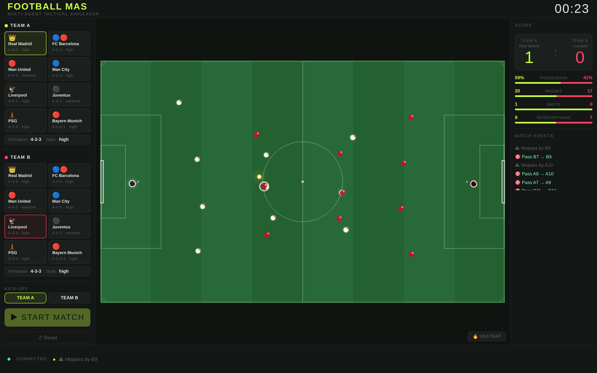

# Football MAS — Multi-Agent Tactical Simulator

[](https://github.com/Haytamzerr/football-mas/actions/workflows/tests.yml)

A football match where **every player is an autonomous agent**. 22 agents perceive the pitch, score their possible actions with utility functions and act, with no central controller telling anyone what to do. Passing lanes, pressing and counter-attacks *emerge* from those individual decisions.

Pick two clubs, press start, and watch a 30-second match play out live in the browser with possession, passes, shots and interceptions updated in real time. An automated 8-match validation mode compares two clubs over several configurations.



> 4th-year engineering project, Multi-Agent Systems module — UEMF (EIDIA), 2025-2026. Supervisor: Mr. Abderrahim Waga.

## Features

- **22 autonomous agents** (goalkeeper, defenders, midfielders, strikers), each running its own *perceive → decide → act* cycle every 50 ms
- **Utility-based decision making**: shoot, pass, dribble, intercept, press, support, hold position
- **8 clubs** with their own formation (4-3-3, 4-4-2, 4-2-3-1…), playing style (aggression) and speed
- **Physics**: ball friction and rebounds, player stamina that drains with effort, dribbling slower than running
- **Live dashboard**: score, timer, possession, passes, shots, interceptions, event feed, heatmap
- **8-match validation suite** alternating kick-off and aggression levels, with aggregated stats and tactical notes
- **REST API** (FastAPI) with interactive docs at `/docs`

## How it works

### Architecture

```
 Browser (index.html, Canvas)            FastAPI server (main.py)
 ───────────────────────────            ─────────────────────────────────────
  club selection  ── POST /start ──►     MatchEnvironment  (environment.py)
  pitch + stats   ◄── GET /state  ──       ├─ Ball (friction, rebounds)
  (polled live)                            ├─ 22 × FootballAgent (agent.py)
  validation      ── POST /validate ►      └─ stats, events, summary
                                         simulation thread: step() every 50 ms
```

The simulation runs in a background thread; a lock protects the shared state so the API can read a consistent snapshot while the match is running.

### The agent cycle

Each step, every agent (in random order, so no team gets an advantage):

1. **Perceive**: builds an observation of the world (ball position and distance, who has the ball, teammates, opponents, distance to goal).
2. **Decide**: gives every action that makes sense in its situation a utility score and picks the highest, with a tiny random noise to break ties.
3. **Act**: moves, passes, shoots or tackles, and updates the ball and its own stamina.

### Utility functions (examples)

| Situation | Action | Utility |
|---|---|---|
| I have the ball | Shoot | `(40 − distance_to_goal) / 40 × 4`, ×1.3 for strikers, 0 for the goalkeeper |
| | Pass | `0.62 + 0.28 × aggression`, +0.2 if the teammate is closer to goal, −0.5 near the goal |
| | Dribble | `0.50 + 0.22 × aggression` (the fallback) |
| My team has the ball | Support | `0.62 + 0.20 × aggression`: find space for a pass |
| The opponents have it | Intercept | `1 − ball_distance / 25` (1.2 if the ball is loose) |
| | Press | `0.30 + 0.52 × aggression` within 30 units of the ball |
| | Hold position | 0.42 for defenders and the goalkeeper, 0.18 for others |

So an aggressive club presses higher and passes forward more, while a defender stays in shape unless the ball comes close. Nobody is scripted to "counter-attack"; it happens when an interception lands near a striker with space.

## Run it

```bash
git clone https://github.com/Haytamzerr/football-mas.git
cd football-mas
pip install -r requirements.txt
python main.py
```

If port 8000 is already used by another program, pick another one: `PORT=8001 python main.py` (PowerShell: `$env:PORT=8001; python main.py`).

Open <http://localhost:8000>, choose a club for each team and press **START MATCH**. The API docs are at <http://localhost:8000/docs>.

### Tests

```bash
pip install pytest httpx
pytest
```

14 tests cover the agents' decisions (a striker in front of goal shoots, a goalkeeper never does, a defender chases a loose ball), whole matches (the ball stays on the pitch, never two carriers, every formation has 11 players), the validation suite (reproducible with a seed, consistent totals) and the API. They run on every push with GitHub Actions.

## API

| Method | Path | What it does |
|---|---|---|
| GET | `/` | The simulator page |
| GET | `/clubs` | List of clubs (name, colours, formation, style) |
| POST | `/start` | Start a match: `{"clubA": "real_madrid", "clubB": "liverpool", "attackTeam": "A"}` |
| GET | `/state` | Live state: positions, ball, score, stats, events (final summary when finished) |
| POST | `/reset` | Stop and clear the match |
| POST | `/validate` | Run 8 full matches between two clubs and return the aggregated stats |
| GET | `/health` | Server status |

## Project structure

```
agent.py         FootballAgent: perception, utility-based decisions, actions, stamina
environment.py   MatchEnvironment: ball physics, formations, possession, stats, validation suite
clubs.py         the 8 clubs and their attributes
main.py          FastAPI server and simulation thread
index.html       Canvas front end (pitch, dashboard, heatmap, validation panel)
tests/           pytest suite (agents, matches, API)
```

## Ideas for next steps

- Agents that communicate (FIPA-ACL style messages: "pass to me", "cover my zone")
- Reinforcement learning to tune the utility weights instead of setting them by hand
- Offside, fouls and set pieces
- Longer matches with substitutions when stamina runs out
